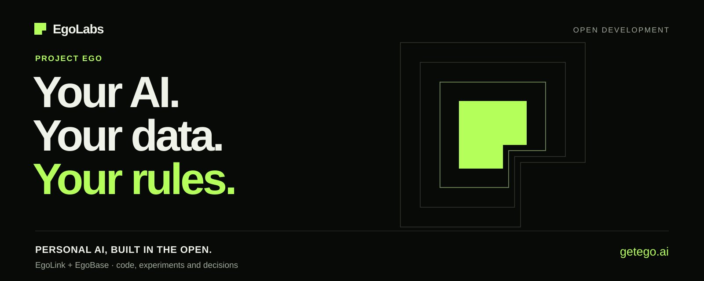
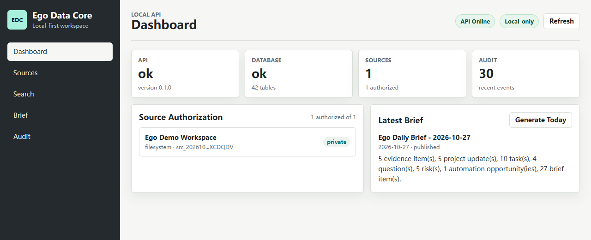
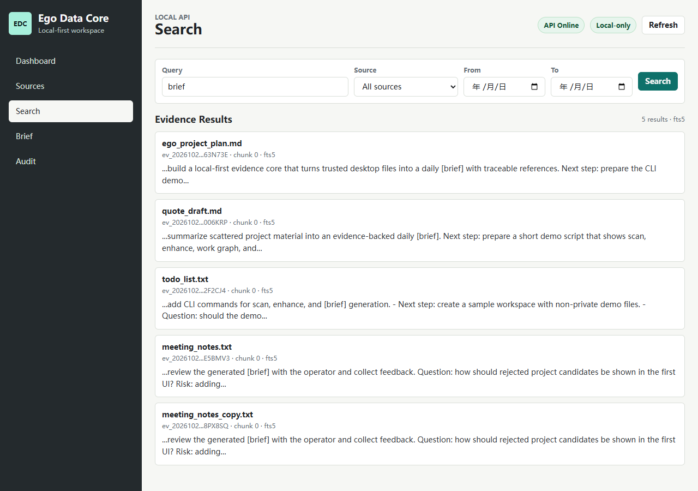

# Ego in pictures / Ego 图片导览

Ego explores personal AI under the user's control. See the product direction and
the current software and hardware below. / Ego 探索由个人掌控的 AI，下面展示产品方向、
当前软件和实物研发。

## The product direction / 产品关系

**Concept illustration / 方向示意。** EgoLink connects to the physical world;
EgoBase is being developed for user-controlled evidence, context and authorized
actions. The computer and board are illustrative, not manufactured product
designs. The full Link-to-Base integration is still being implemented.

EgoLink 是物理观察与交互入口；EgoBase 承接个人掌控的证据、上下文和授权行动。
图中电脑和电路板用于解释关系，不是外观定稿，完整跨设备闭环仍在实现中。

## Software that runs today / 当前可运行的软件

**Data Core · real local UI, synthetic demo data / 真实本地界面、合成演示数据。**
This capture shows the existing Dashboard after running the repository's sample
workspace: one authorized source, stored evidence and a generated daily brief.
It is a screenshot of the running application, not a UI mockup.

这是运行仓库示例工作区后的实际 Dashboard，展示已授权来源、证据和生成的简报。
画面来自现有应用，没有重画界面；其中内容为演示数据。

**Evidence search / 证据检索。** The existing search interface returns five matching
evidence entries for `brief`, with source filenames and excerpts. The input is the
five text files distributed with the project demo, not private user documents.

现有检索界面返回 `brief` 的五条证据结果，保留源文件名与片段。输入是项目自带的
五份示例文本，不是真人私人文档。运行入口见 [Data Core README](../projects/egobase/data-core/README.md)。

## Physical development / 实物研发

The [EgoLink visual tour](https://github.com/getegoai/egolink/blob/main/docs/VISUAL_TOUR.md)
shows actual PCB1 photographs, the engineering status and a short photo brief.
Explore its hardware, firmware and continuing experiments there.

[EgoLink 图片导览](https://github.com/getegoai/egolink/blob/main/docs/VISUAL_TOUR.md)
展示真实 PCB1 照片、当前工程状态，以及持续演进的硬件、固件与实验。

## Ready to share / 可直接取用

| Asset / 图片 | Use / 用途 |
|---|---|
| [Ego cover · SVG](media/ego-cover.svg) · [PNG](media/ego-cover.png) | 1600 × 640，仓库封面、演示文稿 |
| [Social card · PNG](media/ego-social.png) · [SVG master](media/ego-social.svg) | 1200 × 630 PNG，项目介绍配图 |
| [System concept · SVG](media/system/ego-system.svg) | 产品关系解释；请保留概念图说明 |
| [Dashboard](media/screenshots/data-core-workspace.png) · [Evidence search](media/screenshots/data-core-evidence.png) | 软件展示；配文注明合成演示数据 |

Suggested caption / 可用配文：

> Personal AI, built in the open. We're developing EgoLink and EgoBase, sharing
> the code, experiments and decisions as the project takes shape.
>
> 公开构建由个人掌控的 AI。我们正在研发 EgoLink 和 EgoBase，持续分享代码、实验和每一步取舍。

[Sources, license scope and regeneration / 来源、许可与生成方法](media/README.md)。
